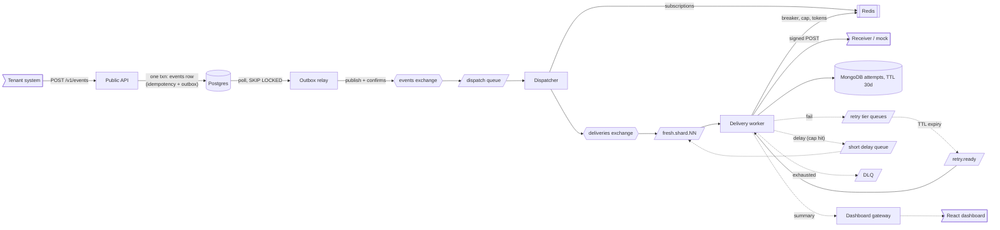

# Webhook Delivery Platform

A multi-tenant platform that accepts events through a public REST API and reliably delivers them, as signed HTTP requests, to every endpoint subscribed to that event type. It takes care of retries with exponential backoff and jitter, rate limiting, circuit breaking for dead endpoints, protection against SSRF, replay of failed deliveries, and a dashboard with a live delivery log.

This is a **learning and portfolio project**. It is designed for a realistic production load (1,000 tenants, 5k events/s peak, fan-out 3, about 15k deliveries/s, first attempt within 5 s at p99), but built and demoed as a thin vertical slice at hundreds of events per second. Every simplification is deliberate and has a documented scale-up path.

> **Status: Phase 1 not started.** The repository currently contains the monorepo skeleton (Bun workspaces, a NestJS "Hello World" API and four empty shared libraries) and a complete PRD. None of the platform features described below exist yet. Sections marked **(planned)** describe the target, not the current behaviour.

## Contents

- [Principles](#principles)
- [Architecture (planned)](#architecture-planned)
- [Tech stack](#tech-stack)
- [Repository layout](#repository-layout)
- [Getting started](#getting-started)
- [Scripts](#scripts)
- [Testing](#testing)
- [Configuration](#configuration)
- [Deployment](#deployment)
- [Roadmap](#roadmap)
- [Documentation](#documentation)

## Principles

- **At-least-once delivery plus idempotency.** Exactly-once over HTTP is impossible. Every attempt carries a stable `webhook-id` so receivers can deduplicate.
- **Atomic acceptance.** An event is either durably accepted and will be published, or rejected. A Postgres outbox avoids dual writes.
- **Isolation over throughput.** A slow endpoint or a noisy tenant must not break the 5 s first-attempt SLA for others.
- **Measure, don't assert.** Every sizing claim gets a measured number from the demo.
- **Simple where it can be, deep where it matters.** Complex behaviour sits behind small, unit-testable modules.

## Architecture (planned)



How it fits together:

1. **Ingest.** `POST /v1/events` writes one row to the `events` table, which is both the idempotency store and the outbox, then returns `202`.
2. **Relay.** The outbox relay polls unpublished rows (about every 100 ms, `FOR UPDATE SKIP LOCKED`) and publishes them to RabbitMQ with publisher confirms.
3. **Dispatch.** The dispatcher fans each event out into one delivery job per subscribed endpoint, idempotent on `delivery_id = hash(event_id, endpoint_id)`.
4. **Deliver.** Workers send a signed, SSRF-safe HTTP POST (3 s connect and 10 s total timeout, no redirects, 64 KB response cap) and log every attempt to MongoDB.
5. **Retry.** Failures go to TTL tier queues (5 s, 30 s, 5 min, 30 min, 2 h, 5 h, 10 h) that dead-letter into a shared `retry.ready` lane, giving 8 attempts over about 17.6 h, then a DLQ. A `TIME_SCALE` factor compresses the schedule for demos.
6. **Protect.** A Redis circuit breaker, a per-endpoint concurrency cap and token bucket, and a per-tenant ingest rate limit keep one tenant or endpoint from harming the others.
7. **Observe.** A React dashboard shows a filterable, virtualized delivery log with live updates over WebSocket and one-click replay.

### Signature scheme (planned, Standard Webhooks style)

Each request carries `webhook-id` (stable across retries), `webhook-timestamp` (regenerated on every attempt) and `webhook-signature: v1,<base64>`, an HMAC-SHA256 over `id.timestamp.rawBody`. During secret rotation the header carries several space-separated signatures. Receivers should reject timestamps older than 5 minutes and deduplicate on `webhook-id`.

## Tech stack

| Area | Choice |
|---|---|
| Language | TypeScript (strict, ESM, `nodenext`) |
| Backend | Node.js 24, NestJS 12 |
| Package manager | Bun workspaces (Node is the runtime) |
| Config and events store | PostgreSQL (planned) |
| Attempt log | MongoDB (planned) |
| Fast state | Redis (planned) |
| Messaging | RabbitMQ with quorum queues (planned) |
| Frontend | React, TanStack Query, Redux, Redux-saga, TanStack Virtual (planned) |
| Realtime | Socket.IO gateway, RxJS batching (planned) |
| Testing | Vitest, Testcontainers (planned) |
| Tooling | oxlint (type-aware), Prettier, Nest's default Logger and prom-client (planned) |

## Repository layout

```
apps/
  api/              @wdp/api: public REST API (currently the NestJS scaffold)
libs/
  domain/           @wdp/domain: aggregates and the delivery state machine
  core/             @wdp/core: deep modules (retry policy, signing, SSRF guard, breaker, ...)
  messaging/        @wdp/messaging: broker contracts and topology
  observability/    @wdp/observability: logging and metrics
docs/
  PRD-v1.0.md       product requirements and locked design parameters
tsconfig.base.json  shared compiler options and @wdp/* path aliases
tsconfig.json       root typecheck over apps/ and libs/
```

The four libraries are empty placeholders. The remaining apps (relay, dispatcher, worker, gateway, mock receiver, dashboard) are added as the phases land.

### How workspace libraries resolve

- **Dev and tests:** `@wdp/*` resolves to each library's `src` through the paths in `tsconfig.base.json`, so no rebuild is needed while editing.
- **Builds:** the build tsconfigs set `"paths": {}`, so imports resolve through `node_modules` to each library's compiled `dist`. `bun run build` builds everything in dependency order.
- **Linking:** an app only gets a library linked once its `package.json` lists it, for example `"@wdp/core": "workspace:*"`, followed by `bun install`.

## Getting started

### Prerequisites

- [Bun](https://bun.sh) (package manager and workspace tool)
- Node.js 24 (runtime)
- Docker and Docker Compose, once the infrastructure stack lands (planned)

### Install and run

```bash
bun install

# API with watch mode
bun run --filter @wdp/api start:dev

# or build everything and run the compiled API
bun run build
bun run --filter @wdp/api start:prod
```

The API listens on `PORT` (default `3000`). Today it answers `GET /` with `Hello World!`.

### Full stack (planned)

Phase 1 adds a `docker compose up` that starts Postgres, MongoDB, Redis, RabbitMQ and the services, plus a mock receiver with configurable failure rate, latency and hang behaviour. This section will be completed then.

## Scripts

Run from the repository root.

| Script | What it does |
|---|---|
| `bun run build` | Builds all libraries and apps in dependency order |
| `bun run typecheck` | Type-checks `apps/` and `libs/` with no emit |
| `bun run lint` | Runs oxlint with type-aware rules |
| `bun run format` | Formats sources with Prettier |
| `bun run test` | Runs unit tests (`*.spec.ts`) |
| `bun run test:watch` | Runs unit tests in watch mode |
| `bun run test:cov` | Runs unit tests with coverage |
| `bun run test:e2e` | Runs end-to-end tests (`*.e2e-spec.ts`) |

Per-app scripts (`start`, `start:dev`, `start:debug`, `start:prod`) live in each app's `package.json` and run with `bun run --filter @wdp/api <script>`.

## Testing

Tests assert external behaviour, and each one exists to catch a regression: it must fail when the bug it targets is present and pass when it is fixed.

| Level | Targets |
|---|---|
| Unit | Retry policy, signature service, SSRF guard, delivery state machine, cursor codec. Pure or nearly pure, table-driven, no containers. |
| Integration (Testcontainers, planned) | Idempotent ingest under concurrent duplicates, outbox relay crash recovery, circuit breaker and limiter against real Redis, the retry topology against a real broker, worker ack ordering. |
| End-to-end (planned) | Event accepted, delivered to the mock receiver, attempt visible through the API. A failing receiver leads to retries, the breaker opening, recovery and success. The same script is the demo. |

## Configuration

Currently only `PORT` is read. The PRD locks these parameters, which become environment variables as each feature lands:

| Variable | Planned default | Purpose |
|---|---|---|
| `PORT` | `3000` | HTTP port of the API |
| `TIME_SCALE` | `1` (demo `30`, tests `1000`) | Divides every retry delay |
| `LANE_COUNT` | `4` locally, `16` in the design | Number of fresh-delivery shards |
| `SECRETS_KEK_V1` | none | Base64 32-byte key that wraps endpoint secrets (AES-256-GCM) |
| `SSRF_ALLOW_HOSTS` | empty | Dev-only allowlist so the Compose mock receiver passes the SSRF guard; keep empty in production |

See [`docs/PRD-v1.0.md`](docs/PRD-v1.0.md), section 6, "Locked parameters", for the full list of values.

## Deployment

There is no deployment yet. The plan:

- **Local and demo:** Docker Compose for the whole stack (Phase 1 onward), with graceful shutdown of 30 s (`stop_grace_period: 30s`) so in-flight deliveries finish.
- **Not built, documented as the next phase:** Kubernetes (k3s) with Helm or Kustomize, GitLab CI/CD, dedicated queues and worker pools for heavy tenants, a partitioned outbox, and payload offloading.

Production readiness notes from the design: three RabbitMQ nodes for quorum queues, network-level egress rules as defence in depth for SSRF, and a KMS-backed `KeyProvider` in place of the environment key.

## Roadmap

| Phase | Goal |
|---|---|
| **1. Foundation and atomic ingestion** | Docker Compose, migrations, tenant, endpoint and subscription CRUD, `POST /v1/events` with idempotency, outbox relay, dispatcher, mock receiver |
| **2. Delivery, retries and DLQ** | Delivery worker with signing and the SSRF-safe client, retry tiers, ack ordering, graceful shutdown, Mongo attempt log |
| **3. Resilience and fairness** | Circuit breaker, token bucket and concurrency cap, sharded lanes, secret encryption and rotation, load test results |
| **4. Dashboard, observability and demo** | React dashboard, live updates and replay, metrics and logs, results table, scripted three-scene demo |

The three demo scenes: (1) kill the receiver and watch retries, the breaker opening and closing, and deliveries resuming; (2) kill a worker mid-delivery and lose nothing; (3) send the same `Idempotency-Key` twice and get one event.

## Documentation

- [`docs/PRD-v1.0.md`](docs/PRD-v1.0.md): the product requirements document, covering scope, user stories, deep modules, implementation decisions and locked parameters, testing strategy, phases and risks.

## License

UNLICENSED. This is a private portfolio project.
