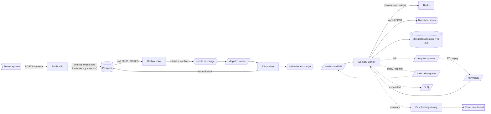
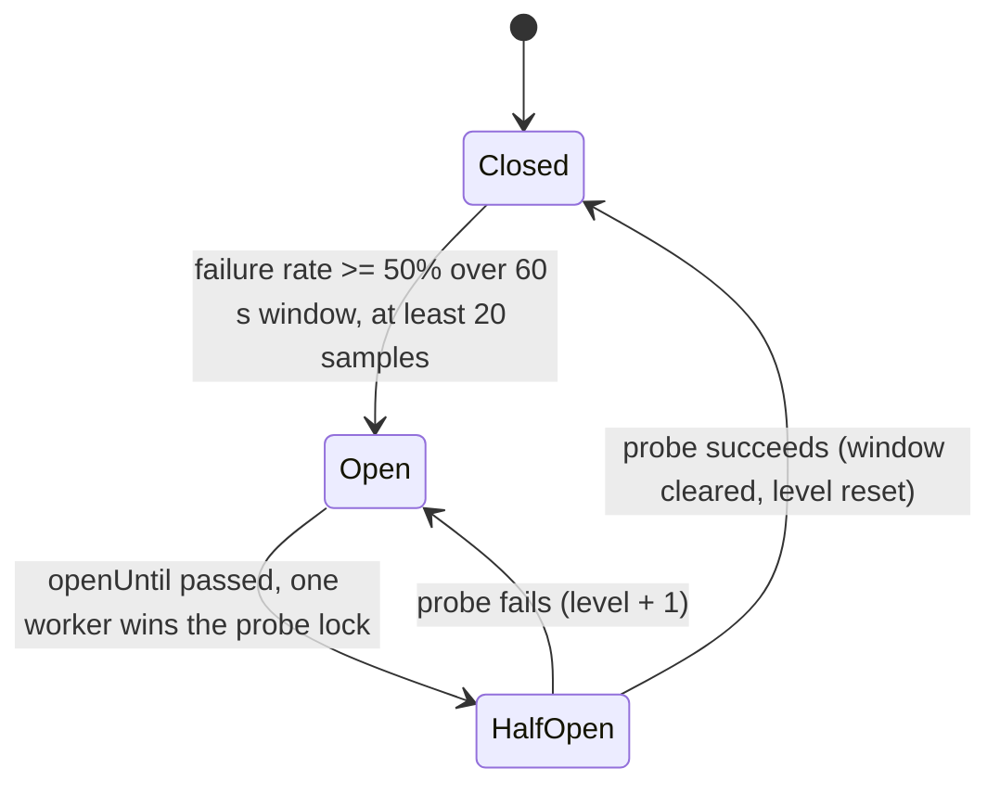

**Status:** Approved
**Date:** 2026-11-12
**Author:** David Hargitai
**Version:** 1.4

# PRD: Multi-tenant Webhook Delivery Platform (Portfolio Project 05, MVP slice)

## 1. Executive Summary & Mission

The platform lets tenants publish events through a public REST API and reliably delivers them, as signed HTTP requests, to every endpoint subscribed to that event type. It handles the hard parts of webhook delivery for the tenant: retries with exponential backoff and jitter, rate limiting, circuit breaking for dead endpoints, protection against SSRF, replay of failed deliveries, and a dashboard with a live delivery log.

This is a **learning and portfolio project**. It is designed for a realistic production load (1,000 tenants, 5k events/s peak, fan-out 3, about 15k deliveries/s, first attempt within 5 s at p99) but **built and demoed as a thin vertical slice at hundreds of events per second**. Every simplification is deliberate and has a documented scale-up path.

**Mission:** deliver every accepted event to every subscribed endpoint **at least once**, never let one tenant or one dead endpoint harm others, and make every decision explainable with numbers.

**Core principles**

- **At-least-once plus idempotency.** Exactly-once over HTTP is impossible (Two Generals). Every attempt carries a stable `webhook-id` so receivers deduplicate.
- **Atomic acceptance.** An event is either durably accepted (and will be published) or rejected. No dual writes.
- **Isolation over throughput.** Fairness and failure containment come first: a slow endpoint or noisy tenant must not break the 5 s first-attempt SLA for others.
- **Measure, don't assert.** Every sizing claim in the design gets a measured number from the demo.
- **Simple where it can be, deep where it matters.** Complex behaviour sits behind small, testable modules.

## 2. Target Users & Problem Statement

**Problem.** A SaaS tenant needs to notify its customers' systems about events (`invoice.paid`, `card.moved`) over HTTP. Receivers are untrusted, slow, flaky, or down for hours. Building reliable delivery per tenant is expensive: retries, signatures, duplicate handling, visibility into failures, and protection against a malicious URL that targets internal infrastructure.

**Users**

| Persona                                                      | Technical comfort | Key pain points                                                                                        |
| ------------------------------------------------------------ | ----------------- | ------------------------------------------------------------------------------------------------------ |
| **Tenant developer** (publishes events, registers endpoints) | High              | Lost events, duplicate deliveries, no idea why a delivery failed, wants safe signature verification    |
| **Tenant operator / support** (watches the dashboard)        | Medium            | Needs to see failures quickly, filter by endpoint, replay failed events without a developer            |
| **Platform operator** (the demo audience, "me")              | High              | Noisy tenants, retry storms, dead endpoints eating capacity, security exposure from user-supplied URLs |
| **Receiver developer** (verifies webhooks)                   | High              | Needs a documented signature scheme, a replay window, and a stable id to deduplicate on                |

## 3. MVP Scope

### In Scope

- ✅ Public REST API (`/v1`): tenants (seeded), API keys, endpoints, subscriptions, event ingestion, replay
- ✅ Event ingestion with `Idempotency-Key`, atomic acceptance through a Postgres outbox, and an outbox relay publishing to RabbitMQ with publisher confirms
- ✅ Dispatcher: fan-out of each event into one delivery job per subscribed endpoint
- ✅ Delivery workers: signed HTTP POST, SSRF-safe connection, timeouts, no redirects, response size cap
- ✅ Retry with exponential backoff and jitter (8 attempts over about 17.6 h, **time-scalable for demos**), TTL plus dead-letter exchange tier queues, final DLQ
- ✅ Fairness: sharded shared lanes, per-endpoint concurrency cap, per-tenant ingest rate limit, fresh traffic separated from retry traffic
- ✅ Redis circuit breaker (closed, open, half-open) and per-endpoint token bucket
- ✅ HMAC signing (Standard Webhooks style), secret storage with encryption at rest, secret rotation with an overlap window
- ✅ MongoDB attempt log with 30-day retention and cursor-paginated queries
- ✅ Replay of a single failed delivery and of an event, reusing the same `webhook-id`
- ✅ React dashboard: endpoint and subscription CRUD, filterable delivery log (virtualized, infinite scroll), live updates over WebSocket, replay button
- ✅ Mock receiver with configurable failure rate, latency, and hang behaviour
- ✅ Docker Compose for the whole stack, structured logs with correlation IDs, a few Prometheus metrics
- ✅ Automated tests (unit for deep modules, integration with real containers, one end-to-end scenario) and a scripted three-scene demo

### Out of Scope

- ❌ Kubernetes (k3s), Helm or Kustomize, GitLab CI/CD (documented as the next phase)
- ❌ Dedicated queues and worker pools for heavy tenants (the design is described and defended, not built)
- ❌ Partitioned outbox, payload offloading to Mongo or object storage, Debezium (described as scale-up path)
- ❌ Kafka as an ingestion log, GraphQL API, event schema registry
- ❌ Payload transformation or filtering (plain forwarding only)
- ❌ Billing, a tenant sign-up flow, SSO, full RBAC (a single seeded user per tenant is enough)
- ❌ Global or per-endpoint ordering guarantees (best effort only)
- ❌ Full OpenTelemetry tracing and Grafana alerting (stretch)

## 4. User Stories

### Tenant developer

1. As a tenant developer, I want to `POST /v1/events` with an event type and JSON payload, so that all my subscribed endpoints receive it.
   _Example:_ `POST /v1/events {"type":"invoice.paid","payload":{"invoice":"INV-42"}}` returns `202 {"event_id":"018f..."}`.
2. As a tenant developer, I want to send an `Idempotency-Key` header, so that retrying a request after a network error never creates a second event.
   _Example:_ the same key sent twice returns the same `event_id`; the same key with a different body returns `422`.
3. As a tenant developer, I want to register an endpoint URL and subscribe it to event types, so that I control who receives what.
   _Example:_ endpoint `https://hooks.acme.test/in` subscribed to `invoice.paid` and `invoice.failed`.
4. As a tenant developer, I want each endpoint to have a signing secret, so that I can verify requests really came from the platform.
   _Example:_ the secret is shown once at creation, as `whsec_...`.
5. As a tenant developer, I want to rotate an endpoint's secret with an overlap window, so that I can deploy the new secret without dropping deliveries.
   _Example:_ for 24 h each request carries two signatures, one per secret.
6. As a tenant developer, I want rejected URLs to be explained, so that I can fix them.
   _Example:_ registering `https://169.254.169.254/` returns `422 url_not_allowed: resolves to a link-local address`.
7. As a tenant developer, I want a documented verification algorithm with a timestamp tolerance, so that replayed captures of old requests are rejected.
   _Example:_ reject if `webhook-timestamp` is more than 5 minutes old.
8. As a tenant developer, I want every retry of the same event to carry the same `webhook-id`, so that my receiver can deduplicate.

### Tenant operator

9. As a tenant operator, I want a delivery log showing each attempt with status, HTTP code, latency and error, so that I can diagnose failures.
10. As a tenant operator, I want to filter the log by endpoint, status and event id, so that I can find a specific problem in millions of rows.
11. As a tenant operator, I want to scroll through the log without waiting for page loads or seeing the UI freeze, so that large histories stay usable.
12. As a tenant operator, I want new attempts to appear live, without losing my scroll position, so that I can watch an incident unfold.
    _Example:_ a "12 new" pill appears; clicking it prepends them.
13. As a tenant operator, I want to replay a failed delivery or a whole event with one click, so that I can recover after the receiver is fixed.
14. As a tenant operator, I want to bulk-replay failed events and be able to cancel it, so that one mistake doesn't trigger a flood.
15. As a tenant operator, I want to see an endpoint's circuit status (closed, open, half-open), so that I understand why deliveries are paused.

### Platform operator and technical stories

16. As the platform operator, I want events to be durably accepted before the client gets `202`, so that no acknowledged event is lost.
17. As the platform operator, I want first attempts to run within 5 s at p99 even when retries are backed up, so that the SLA holds during incidents.
18. As the platform operator, I want a per-tenant ingest rate limit that returns `429` with `Retry-After`, so that one tenant can't overload the broker.
19. As the platform operator, I want a per-endpoint concurrency cap, so that one slow endpoint can't occupy all worker slots.
    _Example:_ an endpoint hanging to its 10 s timeout may hold at most 20 slots.
20. As the platform operator, I want a circuit breaker that stops calling a dead endpoint and probes it for recovery, so that capacity isn't wasted and the receiver isn't hammered.
21. As the platform operator, I want retries scheduled with exponential backoff and jitter, so that a recovered receiver doesn't get a synchronized spike.
22. As the platform operator, I want permanently failed deliveries to land in a DLQ with the failure reason, so that they can be inspected and replayed.
23. As the platform operator, I want a worker that dies mid-delivery to lose nothing, so that crashes are survivable.
    _Example:_ kill a worker during a slow request; the job is redelivered and the receiver sees the same `webhook-id`.
24. As the platform operator, I want workers to shut down gracefully on SIGTERM, so that deploys don't abandon in-flight deliveries.
25. As the platform operator, I want every outbound request to be SSRF-safe at connect time, so that DNS rebinding or redirects can't reach internal hosts.
26. As the platform operator, I want structured logs with a correlation id from ingestion to each attempt, so that an event can be traced across services.
27. As the platform operator, I want metrics for queue depth, delivery success rate and latency percentiles, so that I can show the SLA is met.
28. As a developer of the platform, I want the retry policy, breaker, signing and SSRF logic isolated behind small interfaces, so that they can be unit tested without infrastructure.

## 5. Core Architecture & Deep Modules

### Approach

Several small NestJS services in one repository, communicating through RabbitMQ (and a WebSocket to the browser). Postgres holds transactional configuration and the accepted events (which double as the outbox), MongoDB holds the high-volume attempt log, Redis holds fast disposable state, and RabbitMQ carries delivery jobs. DDD is applied to the delivery core: an `Event` aggregate and a `Delivery` aggregate with an explicit state machine, with infrastructure behind ports.

### Deep modules

Each module hides substantial logic behind a small, stable, testable interface.

| Module                            | Interface (sketch)                                                                                         | Hides                                                                                                                                                                                |
| --------------------------------- | ---------------------------------------------------------------------------------------------------------- | ------------------------------------------------------------------------------------------------------------------------------------------------------------------------------------ |
| **RetryPolicy**                   | `next(attempt, rng) -> {action: retry \| dead, delay, tier, bucket}`                                       | Schedule table, jitter, time-scale factor for demos, attempt budget. Pure function                                                                                                   |
| **SignatureService**              | `sign(secrets[], id, timestamp, rawBody) -> header`; `verify(header, id, timestamp, body, secrets[], now)` | HMAC-SHA256 over `id.timestamp.body`, multiple secrets during rotation, constant-time comparison, tolerance window                                                                   |
| **SsrfGuard / SafeHttpClient**    | `post(url, headers, body) -> Result`                                                                       | DNS resolution, IP deny-list (loopback, RFC1918, link-local, CGNAT, IPv6 ULA, mapped IPv4), IP pinning with correct SNI/Host, no redirects, connect and total timeouts, response cap |
| **CircuitBreaker**                | `allow(endpointId) -> allow \| deny \| probe`; `record(endpointId, outcome)`                               | Redis state machine (closed, open, half-open), thresholds, single-probe election, cooldown                                                                                           |
| **EndpointLimiter**               | `acquire(endpointId) -> Permit \| Denied`; `release(permit)`                                               | Concurrency semaphore and token bucket in Redis (atomic scripts), expiry of leaked permits                                                                                           |
| **DeliveryStateMachine** (domain) | `Delivery.recordAttempt(result) -> events`, `Delivery.replay()`                                            | Legal states and transitions (pending, in-flight, succeeded, retrying, dead), invariants such as attempt budget                                                                      |
| **OutboxRelay**                   | `runOnce() -> publishedCount`                                                                              | Batch selection with `SKIP LOCKED`, publisher confirms, marking `published_at`, crash-safe republish                                                                                 |
| **IdempotentIngest**              | `accept(tenant, key, body) -> {event_id, created}`                                                         | The idempotency decision table (new, duplicate, conflicting payload) inside one transaction                                                                                          |
| **LaneRouter**                    | `lane(delivery) -> routingKey`                                                                             | Hash sharding by endpoint, fresh vs retry vs delay lanes                                                                                                                             |
| **CursorCodec**                   | `encode({ts,id})`, `decode(token)`; filter-to-query builder                                                | Opaque cursor format and tamper handling, keyset query construction                                                                                                                  |

### Design patterns used in the project

State machine (delivery), strategy (retry policy, pluggable breaker thresholds), adapter and ports (HTTP client, broker, stores), repository, circuit breaker, token bucket, outbox, competing consumers, dead-letter exchange, observer (live log updates), builder (log filter to Mongo query).

### Repository layout (logic, not paths)

One monorepo with deployable apps (API, relay, dispatcher, worker, dashboard gateway, mock receiver, dashboard UI) and shared libraries (domain, deep modules, messaging contracts, observability).

## 6. Implementation Decisions

### Ingest and outbox

- **One `events` table is both the idempotency store and the outbox.** Columns: `event_id` (UUIDv7, primary key), `tenant_id`, `idempotency_key` (nullable), `event_type`, `payload` (jsonb), `created_at`, `published_at`. Unique constraint on `(tenant_id, idempotency_key)`. A partial index on unpublished rows keeps relay polling cheap.
- **Decision table** for `POST /v1/events`: new key inserts and returns `202`; same key and same request hash returns the original `event_id`; same key and different hash returns `422`; two concurrent requests with the same key are serialized by the unique index.
- **Relay:** polls unpublished rows in batches with `FOR UPDATE SKIP LOCKED`, publishes with publisher confirms, then sets `published_at`. A crash between publish and mark causes a republish, so consumers must be idempotent (at-least-once).
- **Not built, documented as scale-up:** hourly partitioning (unique constraints on partitioned tables must include the partition key, which is why partitioning needs a separate idempotency table), payload offloading, logical decoding.

### Dispatch and delivery

- `delivery_id = hash(event_id, endpoint_id)`; the dispatcher is idempotent on it.
- **Lanes:** `fresh.shard.00..NN` (a small N for the demo, 16 in the design), shard by `hash(endpoint_id)`; a shared `retry.ready` lane; a short `delay` tier queue. Fresh lanes always get consumer priority.
- **Retry tiers:** one queue per delay (about 5 s, 30 s, 5 min, 30 min, 2 h, 5 h, 10 h), each with a fixed `x-message-ttl` and a dead-letter exchange routing to `retry.ready`. Per-message TTL isn't used, because RabbitMQ expires only at the head of the queue. A **time-scale factor** compresses the schedule for demos.
- **Worker order of operations:** attempt, log attempt, publish retry (or DLQ) and wait for the confirm, **then** ack. A crash in between can duplicate but never lose.
- **Dispatch failures:** the dispatcher reads subscribers from Postgres on every event (the Redis subscription cache is not built; it is a scale-up path). A transient failure (publish error, confirm timeout, lookup error) parks the whole event in a retry queue and re-handles it after a pause, up to `DISPATCHER_MAX_ATTEMPTS`; deterministic `delivery_id`s make the re-handling idempotent. A malformed event, or one whose attempts run out, goes to the DLQ with its reason.
- **Per-endpoint cap exceeded:** park the job in the delay tier without consuming an attempt. Never nack-requeue (it spins).
- **Circuit open:** re-park without calling the endpoint and without consuming an attempt. Half-open: exactly one probe.
- **Quorum queues** with `delivery-limit` for poison messages. Graceful shutdown: cancel consumers, finish in-flight work, close the channel, with a grace period larger than the HTTP timeout. The dev and test brokers are pinned to RabbitMQ 4.4, because the dispatcher's retry relies on its `delivery-limit` behaviour for returned messages (`nack` with requeue never counts toward the limit, `reject` with requeue does).

### Security

- **SSRF:** validate at registration (HTTPS, port allowlist, no userinfo) **and at every connection** (resolve, check, pin the IP); no redirects; 3 s connect and 10 s total timeout; response capped at about 64 KB; the limits are `SafeHttpClient` constructor options, and every failure is a result kind (`http_error`, `redirect`, `response_too_large`, `connect_timeout`, `timeout`, `network_error`, `ssrf_blocked`, `invalid_url`), never a throw. A host that is already an IP literal never reaches the DNS lookup, so the client also takes a `hostCheck`; one `SsrfGuard` supplies both. One blocked address refuses the whole host. Egress restricted by network policy as defence in depth.
- **Signing headers:** `webhook-id` (stable), `webhook-timestamp` (**regenerated on every attempt**, so a 20 h retry still passes a 5-minute window), `webhook-signature: v1,<base64>` over `id.timestamp.rawBody`. Sign the exact bytes sent.
- **Secrets:** encrypted at rest with envelope encryption in Postgres, decrypted only in worker memory with a short cache. API keys are stored hashed with a lookup prefix.

### Attempt log and dashboard

- **Attempt document:** `tenant_id, endpoint_id, event_id, delivery_id, attempt_no, ts, status, http_status, latency_ms, response_snippet (<= 1 KB), error`.
- **Indexes:** all end in `ts desc, _id desc` so the sort is covered: `{tenant_id, ts, _id}`, `{tenant_id, endpoint_id, ts, _id}`, `{tenant_id, status, ts, _id}`, `{tenant_id, event_id, ts, _id}`. Verify each with `explain()`: an index scan and no sort stage.
- **Retention:** a TTL index on `ts` (30 days). If the deleter lags at high insert rates, switch to daily collections that are dropped.
- **Pagination:** opaque keyset cursor `{ts, _id}`, fetch `limit + 1` to know `hasMore`, no exact total count.
- **Live view:** workers publish a small attempt summary to a topic exchange (`tenant.<id>.attempt`). Each gateway instance binds an exclusive auto-delete queue only for connected tenants. The gateway batches with RxJS `bufferTime` per room. Live is best effort; the client catches up through the cursor API.
- **Replay** reads the original payload and creates a new delivery with the **same `webhook-id`** and a fresh attempt counter.

### API contract highlights

Versioned `/v1`; resources `endpoints`, `subscriptions`, `events`, `deliveries`, `attempts`; `Idempotency-Key` on event creation; `429` with `Retry-After`; `202` for async acceptance; problem-details errors; cursor pagination on lists; API-key auth for ingestion and JWT for the dashboard.

### Locked parameters

Values below are the agreed defaults. Each is an environment variable or constant with a single home, so it can be changed in one place and re-measured.

#### Repository and runtime

- **Bun workspaces** for packages, **Node 24** as the runtime in Docker and CI. Workspaces: `apps/*` (api, relay, dispatcher, worker, gateway, mock-receiver, dashboard) and `libs/*` (domain, core for the deep modules, messaging, observability). Package scope `@wdp/*`. No Nx for the MVP.
- This repository is standalone. Shared libraries live inside it; other portfolio projects don't import from it.
- The current single-app scaffold in `src/` was restructured into this layout at the start of Phase 1.

#### Ingest and outbox

| Parameter                        | Value                                                                                                                                                         |
| -------------------------------- | ------------------------------------------------------------------------------------------------------------------------------------------------------------- |
| Max request body / event payload | 64 KB. Delivery messages carry the payload inline for the MVP; offloading is the scale-up path                                                                |
| `Idempotency-Key`                | 1 to 255 characters; same key, same request hash returns the original `event_id`                                                                              |
| `events` row retention           | 30 days (matches the attempt log, so replay always finds its payload); a daily batched purge of published rows older than that                                |
| Per-tenant ingest limit          | Token bucket in Redis: 100 events/s sustained, burst 200; over the limit returns `429` with `Retry-After`                                                     |
| Relay poll interval              | 100 ms; a full batch loops immediately without sleeping                                                                                                       |
| Relay batch size                 | 200 rows, `FOR UPDATE SKIP LOCKED`; publisher-confirm timeout 5 s                                                                                             |
| Correlation id                   | The `event_id` (UUIDv7), carried in every message and log line, plus `delivery_id` per delivery                                                               |
| API keys                         | `whk_<8-char prefix>_<32 random bytes, base64url>`; store the prefix and a SHA-256 hash (the secret has high entropy, so no slow hash); constant-time compare |

#### Retry policy

- **Schedule (7 retries, 8 attempts total):** 5 s, 30 s, 5 min, 30 min, 2 h, 5 h, 10 h, about 17.6 h in total before jitter. Delivery goes to the DLQ after the 8th failed attempt.
- **Jitter:** fixed-TTL tier queues give every message in a queue the same delay, so jitter can't be per message. Each tier therefore has **3 queues** with TTLs of 0.8×, 1.0× and 1.2× the base delay (21 queues in total), and `RetryPolicy.next()` picks the bucket at random through the injected `rng`. It returns `{action, delay, tier, bucket}`.
- **Time scale:** `TIME_SCALE` divides every delay and is applied when the topology is declared (RabbitMQ rejects changing `x-message-ttl` on an existing queue). Queue names encode the effective delay in ms, so a new scale creates new queues instead of failing. Production 1; demo 30 with a floor of 500 ms (tiers become 0.5 s, 1 s, 10 s, 1 min, 4 min, 10 min, 20 min); integration tests 1000 with a floor of 20 ms.
- **What counts as success:** HTTP 2xx. Everything else (3xx, since redirects aren't followed, 4xx, 5xx, timeout, network or SSRF error) is a failed attempt and is retried.

#### Circuit breaker

Per endpoint, state in Redis under hash-tagged keys so they stay on one slot: `cb:{endpointId}:win` (sorted set), `cb:{endpointId}:state` (hash: `state`, `openUntil`, `level`) and `cb:{endpointId}:probe`.

| Parameter                 | Value                                                                                                                                                                   |
| ------------------------- | ----------------------------------------------------------------------------------------------------------------------------------------------------------------------- |
| Window                    | Sliding 60 s, a Redis sorted set scored by timestamp; trimmed on each write and capped at 1000 members                                                                  |
| Trip rule                 | Failure rate of at least 50% with at least 20 samples in the window                                                                                                     |
| Counts as breaker failure | Timeout, connection or SSRF-block error, 5xx, 408, 429                                                                                                                  |
| Counts as breaker success | 2xx and any other 4xx (the endpoint is reachable; the delivery itself still fails and retries)                                                                          |
| Cooldown                  | Exponential: 30 s × 2^level, level 0 to 5, capped at 10 min, with ±20% jitter, stored as `openUntil`                                                                    |
| Open to half-open         | Lazy: evaluated inside `allow()` when `now >= openUntil`, no timer                                                                                                      |
| Probe election            | `SET cb:{id}:probe <workerId> NX PX 15000` (above the 10 s HTTP timeout, so a probe worker that dies can't wedge the circuit); the winner probes, the others are denied |
| Atomicity                 | `record()` (add to window, trim, count, compare, change state) is one Lua script; the probe election is the single `SET NX PX` command                                  |
| Denied delivery           | Re-parked in the short delay tier (5 s, scaled) without calling the endpoint and without consuming an attempt                                                           |

#### Fairness and limits

| Parameter                    | Value                                                                                                                                                                |
| ---------------------------- | -------------------------------------------------------------------------------------------------------------------------------------------------------------------- |
| Fresh lanes                  | `LANE_COUNT` = 4 locally, 16 in the design; shard = `hash(endpoint_id) mod N` (changing N needs a drain; documented)                                                 |
| Consumer split               | Each worker runs fresh-lane consumers with prefetch 20 and the `retry.ready` consumer with prefetch 5, so retries can't take more than 20% of a worker's concurrency |
| Per-endpoint concurrency cap | 20 slots (the PRD example), leased with a 30 s expiry so leaked permits recover; over the cap goes to the delay tier                                                 |
| Per-endpoint token bucket    | 20 requests/s sustained, burst 40, overridable per endpoint                                                                                                          |
| Quorum queues                | `delivery-limit` 5 for poison messages, dead-lettering to the DLQ                                                                                                    |
| HTTP                         | 3 s connect, 10 s total, 64 KB response cap, 1 KB stored snippet, no redirects                                                                                       |
| Graceful shutdown            | 30 s grace (above the HTTP timeout); Compose `stop_grace_period: 30s`                                                                                                |

#### Security

- **SSRF:** HTTPS only, ports 443 and 8443, no userinfo. A dev-only `SSRF_ALLOW_HOSTS` allowlist lets the Compose mock receiver (a private IP, plain HTTP) through. It is off by default and in the SSRF test suite, so the suite still proves every deny-list category.
- **Signing:** secret format `whsec_<base64 of 32 random bytes>`; header `v1,<base64>` with several space-separated signatures during rotation; 5-minute tolerance; 24 h rotation overlap.
- **Secrets at rest:** AES-256-GCM envelope encryption. Each secret gets a random 256-bit data key, wrapped by a key-encryption key from `SECRETS_KEK_V1` (base64, 32 bytes). Stored as `{kek_id, wrapped_dek, iv, ciphertext, tag}`. A `KeyProvider` port lets a KMS adapter replace the env key later. Workers cache decrypted secrets for 60 s.
- **Dashboard auth:** a seeded user per tenant, password hashed with `scrypt` from `node:crypto`, JWT access token valid for 1 h with no refresh in the MVP. The WebSocket handshake carries the token, and the tenant room comes from the token claim, never from client input.

#### Attempt log, live view and observability

- **Retention:** TTL index of 30 days. Switch to daily collections only if the deleter measurably lags at demo load.
- **Pagination:** default page 50, max 200; the cursor is base64url JSON `{ts, _id}`; a malformed cursor returns `400`. Every query adds `tenant_id` from the auth context, so a tampered cursor can't cross tenants.
- **Live view:** **Socket.IO**, with a `tenant:<id>` room per tenant; per-room RxJS `bufferTime(250 ms, maxBuffer 100)`; the client reads it through a Redux-saga `eventChannel`.
- **Metrics (prom-client):** `wdp_outbox_unpublished` (gauge), `wdp_queue_depth{queue}` (gauge), `wdp_delivery_attempts_total{outcome}` (counter), `wdp_delivery_latency_seconds` and `wdp_first_attempt_latency_seconds` (histograms; the second is the 5 s SLA), `wdp_breaker_open_endpoints` (gauge). Endpoint ids stay out of metric labels, so cardinality stays bounded.
- **Logs:** Nest's default `Logger` with `event_id`, `delivery_id`, `attempt_no`, `tenant_id` on every line.

## 7. Technology Stack & Features

| Area                    | Choice                                                                                                                                                   | Why                                                                          |
| ----------------------- | -------------------------------------------------------------------------------------------------------------------------------------------------------- | ---------------------------------------------------------------------------- |
| Language                | TypeScript (strict)                                                                                                                                      | Required skill                                                               |
| Backend                 | Node.js, NestJS (modules, DI, gateways)                                                                                                                  | Required; DDD-friendly structure                                             |
| Config and events store | PostgreSQL                                                                                                                                               | Transactions, unique constraints, `SKIP LOCKED`                              |
| Attempt log             | MongoDB (TTL and compound indexes)                                                                                                                       | High volume, append-only, flexible, queried per tenant and endpoint          |
| Fast state              | Redis                                                                                                                                                    | Token bucket, semaphores, breaker state, config cache                        |
| Messaging               | RabbitMQ (quorum queues, TTL + DLX, publisher confirms, manual acks), via amqplib or a thin wrapper                                                      | Required; the built-in NestJS transport hides what the project aims to learn |
| Frontend                | React, TanStack Query (server state), Redux (UI state), Redux-saga (socket channel, bulk replay with cancellation), TanStack Virtual, `useInfiniteQuery` | Required stack; for showcasing split of responsibilities                     |
| Realtime                | WebSocket (NestJS gateway), RxJS for batching and throttling                                                                                             | Required                                                                     |
| Tooling                 | Docker and Docker Compose, Git, Testcontainers, Nest's default Logger (structured logs), prom-client                                                     | Required and quality signals                                                 |
| AI-assisted development | Used throughout and described honestly in the README (what it accelerated, what was reviewed by hand)                                                    | Matches the job requirement                                                  |

**Third-party integrations:** none required; the mock receiver replaces real customer endpoints.

## 8. Testing Decisions & Success Criteria

### What makes a good test here

Tests assert **external behaviour** (inputs, outputs, messages published, state after a failure), not internal calls. Every test should fail if the bug it targets is present and pass when it's fixed, so each test exists to catch a regression.

| Level                            | Targets                                                                                                                                                                                                                                      | Notes                                            |
| -------------------------------- | -------------------------------------------------------------------------------------------------------------------------------------------------------------------------------------------------------------------------------------------- | ------------------------------------------------ |
| **Unit, strict isolation**       | RetryPolicy (schedule, jitter bounds, budget), SignatureService (known vectors, rotation, tolerance window, tampered body), SsrfGuard (deny-list table, DNS rebinding with a fake resolver, redirects), DeliveryStateMachine, CursorCodec    | Pure or nearly pure; no containers; table-driven |
| **Integration (Testcontainers)** | IdempotentIngest (concurrent duplicates), OutboxRelay (crash between publish and mark, then no loss), CircuitBreaker and EndpointLimiter (real Redis scripts), retry topology (TTL and DLX actually return the message), worker ack ordering | Real Postgres, Redis, RabbitMQ, Mongo            |
| **End-to-end**                   | Event accepted, delivered to the mock receiver, attempt visible via the API; failing receiver leads to retries, a breaker opening, recovery and success                                                                                      | One scenario script, reused as the demo          |

Regression-catching examples: "same `Idempotency-Key` twice yields one event" fails if the unique constraint is removed; "retry attempt after 20 h carries a fresh timestamp" fails if the timestamp is reused; "killing a worker mid-delivery loses no job" fails if ack happens before the retry publish.

### MVP success criteria (measurable)

- **Functional:** the three demo scenes work reliably from a clean `docker compose up`: (1) kill the receiver, watch retries then breaker open and close, then deliveries resume; (2) kill a worker mid-delivery, nothing is lost; (3) send the same `Idempotency-Key` twice, get one event.
- **Correctness:** zero lost events and zero events dispatched twice (apart from documented at-least-once duplicates) across a fault-injection run of at least 10,000 events.
- **Performance, measured and recorded:** sustained ingest of at least 500 events/s locally with p99 time-to-first-attempt under 5 s (the SLA), while a noisy tenant and a dead endpoint are active.
- **Isolation:** with one tenant flooding and one endpoint hanging to timeout, other tenants' p99 first-attempt latency stays within the SLA.
- **Security:** SSRF suite blocks every deny-list category, including a rebinding case; signature verification example in docs works against real output.
- **Observability:** metrics and logs show queue depth, success rate and latency percentiles; one event is traceable by correlation id.
- **Readiness:** each simplification has a written scale-up path, and a results table with measured numbers exists.

## 9. Implementation Phases

Checkmarks show what is built (✅) and what is not yet (⬜). The per-task status lives in the task document.

### Phase 1: Foundation and atomic ingestion

**Goal:** accept events safely and publish them to the broker.

**Deliverables**

- ✅ Monorepo, Docker Compose (Postgres, Mongo, Redis, RabbitMQ), versioned migrations
- ✅ Tenants, API keys, endpoints, subscriptions CRUD with validation
- ✅ `POST /v1/events` with idempotency, the `events` table, per-tenant rate limit
- ✅ Outbox relay with confirms; dispatcher fan-out (idempotent on `delivery_id`)
- ✅ Mock receiver

**Validation:** duplicate-key and concurrent-request tests pass; killing the relay mid-batch loses no event; events reach the dispatch queue.

### Phase 2: Delivery, retries and DLQ

**Goal:** deliver reliably and survive failure.

**Deliverables**

- ✅ Delivery worker with the SafeHttpClient and signing (it consumes the lanes, signs and POSTs each job; a failed attempt is retried through the tiers below)
- ⬜ Retry tier queues with TTL and DLX, `retry.ready` lane, DLQ, time-scale factor (the tiers, `retry.ready` and the time scale are built and used by the worker; a delivery that runs out of attempts is only logged, and the DLQ entry for it is not built)
- ⬜ Correct ack ordering, quorum queues with delivery limit, graceful shutdown (ack ordering, quorum queues and the delivery limit are built; graceful shutdown is not)
- ✅ Mongo attempt log with indexes and TTL (the worker writes one document per attempt before it acks; nothing reads it through the API yet)

**Validation:** failing receiver produces the scheduled attempts then a DLQ entry; killed worker loses nothing; retry timestamps are fresh while `webhook-id` is stable.

### Phase 3: Resilience and fairness

**Goal:** protect capacity and isolate tenants.

**Deliverables**

- ⬜ Redis circuit breaker with half-open probe; token bucket; per-endpoint concurrency cap with the delay tier
- ⬜ Sharded fresh lanes, separation of fresh and retry consumption priority
- ✅ SSRF guard test suite
- ⬜ Secret encryption and rotation
- ⬜ Load test with a noisy tenant and a hanging endpoint; recorded results

**Validation:** isolation criterion met with numbers; breaker open and recover observed; SSRF suite green.

### Phase 4: Dashboard, observability and demo

**Goal:** make it demoable and defensible.

**Deliverables**

- ⬜ React dashboard: endpoints and subscriptions, virtualized infinite delivery log with filters, live updates ("N new" pill), replay and cancellable bulk replay (Redux-saga)
- ⬜ Dashboard gateway with per-tenant bindings and RxJS batching
- ⬜ Prometheus metrics, structured logs with correlation ids
- ⬜ README with architecture, decisions, scale-up table, measured results, and the demo script; optional GitLab CI and k3s notes as the next step

**Validation:** all three demo scenes run end to end; `explain()` outputs saved for the log queries; README results table complete.

## 10. Open Questions, Assumptions & Risks

### Open Questions

1. ~~**Circuit breaker design.**~~ **Decided:** sliding-window failure rate, exponential cooldown, `SET NX PX` probe election; values under "Locked parameters".
2. ~~**Repository tooling:** pnpm workspaces vs. Nx.~~ **Decided: Bun workspaces** (no Nx for the MVP; revisit if build or CI time hurts).
3. ~~**Socket library.**~~ **Decided: Socket.IO.**
4. ~~**Retry demo scale.**~~ **Decided:** `TIME_SCALE` 30 with a 500 ms floor for demos, 1000 for tests. A retry-window decision was made too: keep the 7 tiers, about 17.6 h in total.
5. ~~**Secret encryption for the demo.**~~ **Decided:** AES-256-GCM envelope encryption with an env-provided key behind a `KeyProvider` port.
6. **Attempt log retention:** TTL index (30 days) is the default; the switch to daily collections stays conditional on measuring the deleter at demo load.
7. ~~**Relay trigger:** polling interval versus `LISTEN/NOTIFY` for lower latency.~~ **Decided: polling** (about 100 ms, tunable batch size). `LISTEN/NOTIFY` as a wake-up hint on top of polling is the documented scale-up path, only if measurements show relay latency matters. Still to tune: the interval.
8. ~~**Lane count for the demo.**~~ **Decided:** 4 locally, 16 in the design, via `LANE_COUNT`.
9. ~~**Dashboard auth.**~~ **Decided:** seeded user per tenant, scrypt password hash, 1 h JWT.
10. ~~**Where the project lives.**~~ **Decided:** standalone repo, Bun workspaces with `apps/*` and `libs/*`, no sharing with other portfolio projects.

### Assumptions

- Demo load is hundreds of events/s on one machine; the 5k/s design is validated by reasoning and targeted measurements, not by a full-scale test.
- Postgres can sustain the outbox insert rate for the demo (to be confirmed with `pgbench`).
- Receivers are untrusted and may be slow; delivery timeout 10 s, connect timeout 3 s.
- At-least-once delivery with best-effort ordering is acceptable to the MVP.
- One broker cluster of one node is acceptable for local development; three nodes with quorum queues are the production description.
- A single seeded user per tenant is enough for the dashboard.

### Risks & Mitigations

| Risk                                                                                          | Impact                                                        | Mitigation                                                                                                                           |
| --------------------------------------------------------------------------------------------- | ------------------------------------------------------------- | ------------------------------------------------------------------------------------------------------------------------------------ |
| **Scope creep** into infrastructure (k8s, CI, full observability) in a short time frame       | Core flows unfinished or not demoable                         | Phase gates; k3s, CI and tracing explicitly out of scope; phases 1 to 3 finished before any polish                                   |
| **Retry topology bugs** (messages looping, lost on dead-letter, wrong tier)                   | Unreliable core behaviour, hard to debug                      | Integration tests against a real broker for every transition; a fast time-scale factor; log the attempt number and tier              |
| **Duplicate and lost-message edge cases** hidden in ack ordering                              | Violated delivery guarantee                                   | Fixed order (retry confirm, then ack); fault-injection run of 10k events; assert counts                                              |
| **Security mistakes in SSRF handling** (check-then-connect races, redirects, IPv6 forms)      | A critical vulnerability story in a security-aware discussion | Check in the connect step with a pinned IP; table-driven deny-list tests; no redirects; network-level egress rule                    |
| **Performance claims without numbers** (outbox throughput, Mongo TTL deletion, relay latency) | Architectural decisions that can't be defended                | Measure early: `pgbench` for the outbox insert, an ingest load test, `explain()` for log queries; record in the README results table |
